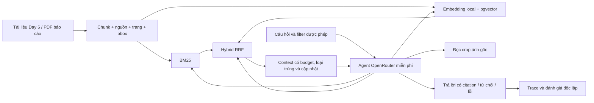

# Thiết kế triển khai

CLI và giao diện Streamlit dùng chung package `day7_rag`. Các module import nhẹ; embedding chỉ được tải khi người dùng thực sự chạy dense/hybrid hoặc index. Không có mock adapter trong luồng chạy sản phẩm.

## Luồng dữ liệu

## Hợp đồng

- Chunk: `id`, `text`, `source_id`, `source`, `page`, `metadata`; thêm `content_type`, `bbox`, `pdf`, `image`, `page_image` khi có. Trang là **trang PDF vật lý, bắt đầu từ 1**. Bbox là point, `[x0,y0,x1,y1]`, gốc ở góc trên trái của trang chưa xoay.
- Câu hỏi: `id`, `split`, `question`, `answerable`; câu có đáp án cần `expected_answer` và `gold` hoặc `evidence_sets`. `gold` là các evidence thay thế. `evidence_sets` dùng OR giữa các tập, AND giữa các evidence trong một tập. `region_id` yêu cầu truy xuất đúng vùng tương ứng.
- Câu không đủ evidence cần `absence_reason` và cách kiểm tra; không nằm trong mẫu số retrieval metrics.
- `runtime_question()` chỉ chuyển `question` và `filter` sang agent. Expected answer, gold, group và nhãn không được truyền vào model hoặc retriever.
- Kết quả: `answered`, `abstain`, `error`; job có thể `pending/paused_quota` trước khi hoàn thành. Một câu lỗi đã chốt không được lặng lẽ chạy lại để chọn đáp án đẹp hơn.

## Tương thích Day 6

Adapter đọc `public.chunks`, mặc định `strategy_b`; mọi connection đọc bật `default_transaction_read_only`. Kiểm tra số chiều và so khớp ID/nội dung/trang/nguồn với export trước khi so sánh. Day 6 không lưu tên model/revision trong DB nên phần tên model vẫn dựa trên cấu hình người vận hành và tài liệu nguồn, không được nhận là đã tự xác minh chỉ từ số chiều.

Metadata chương kế thừa là ánh xạ ở cấp trang; một trang có thể chứa điểm chuyển chương. Cần audit ranh giới nếu dùng filter chương cho câu hỏi nằm gần ranh giới, không suy ra filter từ gold.

Index mới nằm trong `rag_day7.indexes` và `rag_day7.chunks`. ID phiên bản gắn hash corpus, model, revision HF đã resolve, chiều, max length, normalization và manifest nguồn. Encode có cache theo nội dung; chỉ công bố index trong transaction sau khi encode xong. Không xóa/ghi đè `public.chunks`.

## Retrieval và context

BM25 dùng NFC, casefold và tokenizer Unicode; tham số `k1=1.5`, `b=0.75`. Dense dùng cosine trên embedding đã chuẩn hóa. Hybrid dùng `sum(1/(60+rank))`; giữ điểm và rank của từng nhánh, không cộng trực tiếp BM25 score với cosine score. Filter chỉ nhận các scalar JSON và phải tồn tại trong export; giá trị được bind trong SQL.

Context hợp nhất ranking giữa các lượt, loại trùng theo ID và ưu tiên evidence mới khi điểm hòa. Đơn vị budget là **số byte UTF-8 làm cận trên bảo thủ cho token text**, không phải tokenizer riêng của model. Header nguồn cũng tính vào budget. Budget này chỉ áp dụng phần evidence text; token thực tế của system, câu hỏi, lịch sử tool và ảnh được lấy từ API usage. Chunk không vừa bị bỏ, không cắt mất điều kiện giữa chừng.

Citation validator kiểm tra ID, marker trong câu trả lời và context thực tế. Citation của vùng trực quan cần một lượt `view_image` trước đó. Đây là kiểm tra cấu trúc, không chứng minh semantic grounding; đánh giá cuối vẫn cần người chấm đối chiếu nguồn.

## OpenRouter và checkpoint

Chỉ nhận endpoint chính thức, model `:free` có cả ảnh/tools/tool_choice và mọi giá catalog bằng 0. Không gọi plugin trả phí; không có danh sách model fallback. Preflight đọc `/models` và `/key`; không lưu key vào trace. API báo chi phí khác 0 thì dừng cả job.

SQLite chỉ là **sổ đếm request**, không được dùng giả làm vector store. Sổ đếm dùng transaction để chia sẻ ngân sách giữa CLI/UI và đóng connection rõ ràng trên Windows. Mặc định 10 request/phút, 45 request/ngày UTC; lấy quota thật từ OpenRouter nếu endpoint cung cấp. Retry tối đa ba lần cho lỗi tạm thời. 429 hoặc hết ngân sách lưu checkpoint, không giả thành câu từ chối. Chạy lại cùng lệnh để tiếp tục; thay corpus/config/model/code phải dùng lượt chạy mới.

## PDF và giới hạn đã biết

Pipeline xử lý mọi trang, gom block text gần nhau thành vùng tối đa 1.600 ký tự; giữ bbox chứa toàn bộ vùng. Trích bảng đầy đủ và ô/hàng/cột, đồng thời giữ ảnh gốc. Figure detector xem caption, ảnh nhúng và vector drawings; khi chưa tách chắc biên hình thì dùng cả trang làm vùng bảo thủ. Bảng/biểu đồ có thể trích sai thứ tự hoặc ligature; cả native extraction lẫn mô tả vision đều không được mặc nhiên xem là đã đúng.

`describe` là bước bổ sung độc lập với câu hỏi, có cache và tiếp tục qua nhiều ngày. Nội dung sinh được gắn `generated_unverified`. Coverage report ghi mọi trang và cảnh báo; vẫn cần audit các vùng detector bỏ sót. Bìa có ảnh bản quyền riêng không được dùng làm evidence trực quan. File gốc/crop ở `work/` không được commit; chú thích quyền của từng thành phần phải được kiểm tra trước khi chia sẻ.

## Đánh giá

Hit@1/Hit@3 dùng ranking query gốc. Với multi-hop, hit nghĩa là đủ tất cả evidence trong một tập hợp thay thế, có thể ở nhiều chunk trong prefix; quy tắc này được ghi rõ trong summary. Context Evidence Rate kiểm tra context cuối. Các truy vấn agent viết lại được giữ trong trace và không thay thế ranking query gốc.

`review` yêu cầu nhãn, lý do và xác nhận đọc nguồn gốc cho mọi câu chạy thành công. Basic báo lỗi riêng; advanced tính lỗi không đạt trên toàn bộ test. `27/30` đạt ngưỡng; so sánh bằng số nguyên, không làm tròn. Freeze gắn kết quả dev đã audit với cấu hình, model, code, corpus và hash test. Không có ngưỡng chất lượng cơ bản hay bonus được tuyên bố khi chưa có kết quả agent thật.
